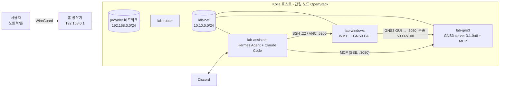

# homelab-agent

단일 노드 **Kolla-Ansible OpenStack** 위에 **AI 비서 + GNS3 네트워크 실습망**을 올리는 홈랩 구축 기록입니다.
비슷한 홈랩을 가진 분이 자기 환경에 맞춰 그대로 따라 할 수 있도록, 실제 비밀번호·토큰·키는 모두 `<PLACEHOLDER>` 형태로 바꿔 두었습니다.

## 무엇을 만드나

OpenStack 테넌트 안에 VM 3대를 만들고, AI 비서가 GNS3 서버(MCP)와 Windows 실습 PC를 직접 다루게 합니다.

| VM | 역할 | 주요 구성 |
|---|---|---|
| `lab-assistant` | AI 비서 | Hermes Agent + Claude Code, Discord로 대화 |
| `lab-gns3` | 실습망 엔진 | GNS3 server **3.1.0a6** (내장 MCP), QEMU/KVM 중첩 가상화 |
| `lab-windows` | 실습용 데스크톱 | Windows 11, GNS3 GUI. 비서가 SSH/VNC로 조작 |

사용자는 집 공유기의 **WireGuard**로 홈 LAN에 들어온 뒤, LAN 대역의 Floating IP로 각 VM에 접근합니다.



ASCII 버전:

```
[사용자] --WireGuard--> [홈 공유기] --- LAN 192.168.0.0/24 (provider, Floating IP .200-.230)
                                              |
                                        [lab-router]
                                              |
                              lab-net 10.10.0.0/24 (예시)
               +------------------------------+------------------------------+
               |                              |                              |
      lab-assistant (FIP 예: .202)   lab-gns3 (FIP 예: .201)        lab-windows (FIP 예: .203)
      Hermes Agent + Claude Code     GNS3 server 3.1.0a6 + MCP      Win11 + GNS3 GUI
      Discord 봇                     :3080 API/MCP, 5000-5100 콘솔   :22 SSH, :5900 VNC (비서 전용)
               |---- MCP over SSE ---------->|                              |
               |---- SSH / VNC --------------------------------------------->|
```

> 위 주소(192.168.0.0/24, 10.10.0.0/24, .201~.203)는 **예시**입니다. 자기 LAN 대역에 맞게 바꾸세요.

## 호스트 요구사항

- Ubuntu 24.04 + Kolla-Ansible 단일 노드 (이 문서는 **2026.1**, 이미지 태그 `2026.1-ubuntu-noble` 기준)
- Intel VT-x(또는 AMD-V) + **중첩 가상화**(nested) 활성화 — GNS3 안에서 QEMU 장비를 KVM으로 돌리기 위해 필수
- 예시 하드웨어: i3-12100F (4C/8T), RAM 62GB
  - 세 VM 합계: vCPU 14 / RAM 40GB / 디스크 240GB (오버커밋 전제)
- Neutron provider(flat) 네트워크가 홈 LAN에 브리지되어 있을 것 (`physnet1` ↔ `br-ex`)
- Nova `enable_nova_swtpm` 활성화 (Windows 11 vTPM용)
- 공유기에서 WireGuard 서버 사용 가능 (외부 접속용, 선택)
  - **밖에서 쓰는 와이파이가 집과 같은 대역(예: 192.168.0.0/24)이면** 맥이 집 서버 주소를 VPN이 아니라 현재 랜으로 보냅니다. WireGuard 터널의 `AllowedIPs`에 서버·VM 주소를 콕 집어 넣으면 해결됩니다. 예: `0.0.0.0/0, 192.168.0.100/32, 192.168.0.200/29`. 더 구체적인 경로(/32, /29)가 직접 연결된 /24보다 우선합니다. "Exclude private IPs"는 끕니다.
  - 보안그룹에 WireGuard 클라이언트 대역도 허용해야 합니다. [docs/01](docs/01-openstack-reset-and-base.md) 보안 그룹 절 참고.

## 문서 목차

| # | 문서 | 내용 | 상태 |
|---|---|---|---|
| 00 | [docs/00-host-check.md](docs/00-host-check.md) | Kolla 호스트 점검 (nested, vmx, CLI, 용량) | 완료 |
| 01 | [docs/01-openstack-reset-and-base.md](docs/01-openstack-reset-and-base.md) | 테넌트 초기화(선택), 네트워크·flavor·SG·이미지·서버 생성 | 완료 |
| 02 | [docs/02-gns3-server.md](docs/02-gns3-server.md) | GNS3 server 3.1.0a6 + 내장 MCP 설치·검증 | 완료 |
| 03 | [docs/03-windows-vm.md](docs/03-windows-vm.md) | Windows 11 VM 첫 부팅 자동화(SSH/VNC/RDP), GNS3 GUI 3.1.0a6 | 완료 (GUI 원격 서버 연결은 수동) |
| 04 | [docs/04-hermes-agent.md](docs/04-hermes-agent.md) | AI 비서 VM: Hermes Agent (ChatGPT Plus → OpenRouter 무료 모델 폴백), reader/ops 봇 분리, 승인 정책 | 완료 (OAuth·API 키·Discord 토큰은 수동) |
| 05 | [docs/05-mcp.md](docs/05-mcp.md) | MCP 연동: GNS3 내장 MCP, Windows-MCP(자동 로그온), mcp-vnc(예비), netmiko_mcp | 완료 |
| 06 | [docs/06-claude-code.md](docs/06-claude-code.md) | Claude Code + Discord 채널 (Claude 구독), 권한 relay, systemd+tmux | 서버 준비 완료 (로그인·봇 토큰·페어링은 수동) |
| 07 | [docs/07-openstack-agent.md](docs/07-openstack-agent.md) | 봇에게 OpenStack 주기: admin 키+감사 로그(`osadmin`)+핵심 VM lock, 최소 권한 경로 lab-agent 프로젝트·쿼터, Nova 정책, 앱 크리덴셜 access_rules, lab-bridge(GNS3 연결), Kali 이미지, `oslab` 스킬 | 완료 |
| — | [docs/research/2026-10-agent-landscape.md](docs/research/2026-10-agent-landscape.md) | 셀프호스트 AI 비서 에이전트 비교 조사 (2026-10) | 참고 |

### 스크립트 / 설정 예시

| 파일 | 용도 |
|---|---|
| [scripts/ubuntu-cloud-config.yaml](scripts/ubuntu-cloud-config.yaml) | Ubuntu VM 공통 cloud-init user_data |
| [scripts/windows-userdata.ps1](scripts/windows-userdata.ps1) | Windows 첫 부팅 스크립트 (Cloudbase-Init) |
| [scripts/windows-autologon.ps1](scripts/windows-autologon.ps1) | Windows 자동 로그온 (전원 끄고 켜도 로그온, Windows-MCP용) |
| [scripts/windows-rdp-autoconsole.ps1](scripts/windows-rdp-autoconsole.ps1) | RDP 창을 닫으면 세션을 콘솔로 자동 복귀 + Windows-MCP 재시작 루프 |
| [scripts/lab-windows-power](scripts/lab-windows-power) | Kolla 호스트용 lab-windows 전원 제어 명령 (start/stop/status만) |
| [scripts/gns3_server.conf.example](scripts/gns3_server.conf.example) | GNS3 server 설정 템플릿 |
| [scripts/gns3server.service](scripts/gns3server.service) | GNS3 server systemd 유닛 |
| [scripts/hermes/](scripts/hermes/) | Hermes 설정·`.env` 예시, netmiko 설정, Windows-MCP 설치 스크립트 |
| [scripts/openstack/](scripts/openstack/) | Nova 정책, access_rules, `oslab` 래퍼, OpenStack 스킬 SKILL.md, netplan 예시 |
| [scripts/claude-code/](scripts/claude-code/) | Claude Code systemd 유닛, CLAUDE.md 규칙, 권한 deny 예시 |

## 비밀값 관리

- 문서와 스크립트의 `<GNS3_PASSWORD>`, `<WIN_ADMIN_PASSWORD>`, `<VNC_PASSWORD>`, `<SSH_PUBLIC_KEY>`, `<FLOATING_IP_GNS3>` 등은 모두 자리표시자입니다.
- 실제로 생성한 비밀번호/토큰은 **Kolla 호스트의 권한 600 env 파일**(예: `~/lab-secrets.env`)에만 보관했고, 저장소에는 넣지 않았습니다.

  ```bash
  umask 077
  cat > ~/lab-secrets.env <<'EOF'
  GNS3_PASSWORD=<openssl rand -base64 18 결과>
  GNS3_JWT_SECRET=<openssl rand -hex 32 결과>
  GNS3_COMPUTE_PASSWORD=<openssl rand -hex 16 결과>
  WIN_ADMIN_PASSWORD=<강한 비밀번호>
  VNC_PASSWORD=<8자 이하>
  EOF
  chmod 600 ~/lab-secrets.env
  ```

- `.gitignore`에서 `*.env`, `secrets/` 등을 제외합니다. 스크립트에 값을 채운 사본은 저장소 밖에서 만드세요.

## 라이선스

[LICENSE](LICENSE) 참조.
