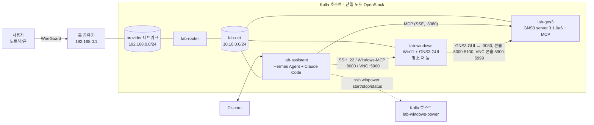

# homelab-agent

단일 노드 Kolla-Ansible OpenStack 위에 AI 에이전트와 GNS3 실습망을 구성하는 홈랩 구축 기록입니다.
비슷한 홈랩을 운영하는 분이 자기 환경에 맞게 적용할 수 있도록, 실제 비밀번호·토큰·키는 모두 `<PLACEHOLDER>` 형태로 바꿔 두었습니다.

## 개요

OpenStack 테넌트 안에 VM 3대를 만들고, AI 에이전트가 GNS3 서버(MCP)와 Windows 실습 PC를 직접 조작하게 합니다.

| VM | 역할 | 주요 구성 |
|---|---|---|
| `lab-assistant` | AI 에이전트 | Hermes Agent + Claude Code, Discord로 대화 |
| `lab-gns3` | 실습망 엔진 | GNS3 server 3.1.0a6 (내장 MCP), QEMU/KVM 중첩 가상화 |
| `lab-windows` | 실습 데스크톱 | Windows 11, GNS3 GUI. `lab-assistant`가 `ssh win`(명령)·Windows-MCP `:8000`(화면)·VNC(로그온 화면)로 조작. 평소에는 꺼져 있고 `ssh winpower start\|stop\|status`로 켜고 끔 |

사용자는 집 공유기의 WireGuard로 홈 LAN에 들어온 뒤, LAN 대역의 Floating IP로 각 VM에 접근합니다(보안 그룹에 WireGuard 대역도 허용).

`lab-windows`는 평소 꺼져 있습니다(SHUTOFF). 봇이 Windows 작업 전에 Kolla 호스트의 전원 전용 명령(`ssh winpower start`, [scripts/lab-windows-power](scripts/lab-windows-power))으로 켜고, 끝나면 끕니다. 켜지면 자동 로그온되고 Windows-MCP(`:8000`, `lab-assistant`에서만 접근 가능)가 자동으로 시작됩니다.



ASCII 버전:

```
[사용자] --WireGuard--> [홈 공유기] --- LAN 192.168.0.0/24 (provider, Floating IP .200-.230)
                                              |
                                        [lab-router]
                                              |
                              lab-net 10.10.0.0/24 (예시)
               +------------------------------+------------------------------+
               |                              |                              |
      lab-assistant (FIP 예: .202)   lab-gns3 (FIP 예: .201)        lab-windows (FIP 예: .203, 평소 꺼 둠)
      Hermes Agent + Claude Code     GNS3 server 3.1.0a6 + MCP      Win11 + GNS3 GUI
      Discord 봇                     :3080 API/MCP, 5000-5100 콘솔   :22 SSH, :8000 Windows-MCP, :5900 VNC (lab-assistant 전용)
                                                                    :3389 RDP (LAN + WireGuard)
               |---- MCP over SSE ---------->|                              |
               |---- SSH / Windows-MCP / VNC ------------------------------->|
               |---- ssh winpower start|stop|status --> Kolla 호스트 (lab-windows-power)
```

> 위 주소(192.168.0.0/24, 10.10.0.0/24, .201~.203)는 **예시**입니다. 자기 LAN 대역에 맞게 바꾸세요.

## 호스트 요구사항

- Ubuntu 24.04 + Kolla-Ansible 단일 노드 (이 문서는 2026.1, 이미지 태그 `2026.1-ubuntu-noble` 기준)
- Intel VT-x(또는 AMD-V)와 중첩 가상화(nested) 활성화: GNS3 안에서 QEMU 장비를 KVM으로 실행하는 데 필요
- 예시 하드웨어: i3-12100F (4C/8T), RAM 62GB
  - 세 VM 합계: vCPU 14 / RAM 48GB / 디스크 310GB (overcommit 전제)
    - `lab-gns3` 24GB/120GB, `lab-assistant` 8GB/40GB, `lab-windows` 16GB/150GB (`lab.windows16`)
    - 꺼 둔 VM도 flavor만큼 메모리를 예약(placement)합니다.
- Neutron provider(flat) 네트워크가 홈 LAN에 브리지되어 있을 것 (`physnet1` ↔ `br-ex`)
- Nova `enable_nova_swtpm` 활성화 (Windows 11 vTPM용)
- 공유기에서 WireGuard 서버 사용 가능 (외부 접속용, 선택)
  - 외부 Wi-Fi가 집과 같은 대역(예: 192.168.0.0/24)을 쓰면 Mac이 집 서버로 가는 트래픽을 VPN이 아니라 현재 LAN으로 보냅니다. WireGuard 터널의 `AllowedIPs`에 서버·VM 주소를 명시적으로 넣으면 해결됩니다. 예: `0.0.0.0/0, <KOLLA_HOST>/32, <FIP 대역>/29` (예시 값: `0.0.0.0/0, 192.168.0.100/32, 192.168.0.200/29`). 더 구체적인 경로(/32, /29)가 직접 연결된 /24보다 우선합니다. "Exclude private IPs"는 끕니다.
  - 보안 그룹에 WireGuard 클라이언트 대역(`<WG_SUBNET>`)도 허용해야 합니다. [docs/01](docs/01-openstack-reset-and-base.md#b-5-보안-그룹) 보안 그룹 절 참고.

## 시작하기

스크립트와 설정 예시를 쓰는 머신에 이 repo를 clone합니다. 문서의 `<REPO>`는 clone한 경로이고, 명령에서는 `$REPO` 변수로 씁니다.

| 머신 | 언제 | 쓰는 문서 |
|---|---|---|
| Kolla 호스트 | 처음([00](docs/00-host-check.md)) | 01(user_data, SSH 별칭), 02(GNS3 설정 파일을 lab-gns3로 복사), 03, 05(Windows 자동 로그온·전원 명령), 06(Claude Code용 GNS3 API 키를 lab-gns3에서 `lab-assistant`로 옮김), 07(Nova 정책·access rules·netplan) |
| `lab-assistant` VM | VM을 만든 뒤([04](docs/04-hermes-agent.md) 시작) | 04~08 (Hermes·MCP·Claude Code 설정, wrapper 스크립트) |

```bash
git clone https://github.com/Nekonic/homelab-agent.git ~/homelab-agent
REPO=~/homelab-agent        # 새 셸마다 다시 지정 (또는 ~/.bashrc 에 추가)
```

인터넷이 안 되는 머신이면 PC에서 clone한 뒤 `scp -r homelab-agent <사용자>@<머신>:` 으로 복사해도 됩니다. lab-gns3·lab-windows에는 repo를 clone하지 않고, 필요한 파일만 Kolla 호스트나 `lab-assistant`에서 복사합니다.

### Placeholder 목록

문서와 스크립트는 아래 이름을 공통으로 씁니다. 표의 값은 이 홈랩의 **예시**입니다.

| Placeholder | 뜻 | 예시 |
|---|---|---|
| `<KOLLA_HOST>` / `<KOLLA_USER>` | Kolla 호스트 LAN 주소 / sudo 사용자 | `192.168.0.100` / `master` |
| `<GNS3_FIP>` / `<ASSISTANT_FIP>` / `<WIN_FIP>` | 각 VM의 Floating IP (LAN) | `192.168.0.201` / `.202` / `.203` |
| `<GNS3_LAB_IP>` / `<ASSISTANT_LAB_IP>` / `<WIN_LAB_IP>` | 각 VM의 lab-net 주소. Kolla 호스트에서 `os server show lab-windows -c addresses`로 확인하고 다른 VM은 이름만 바꿈. [01 D-5](docs/01-openstack-reset-and-base.md#d-5-kolla-호스트-ssh-별칭-설정) | `10.10.0.x` |
| `<WG_SUBNET>` | 공유기 WireGuard 클라이언트 대역 | `10.158.157.0/24` |
| `<VIP>` | Kolla 내부 API VIP | `192.168.0.110` |
| `<REPO>` | 이 repo를 clone한 경로 | `~/homelab-agent` |
| `<WIN11_QCOW2>` | Windows 11 qcow2 이미지 파일 이름(확장자 제외). 파일은 Kolla 호스트 `~/lab-images/`에 둠 ([01 C-2](docs/01-openstack-reset-and-base.md#c-2-windows-11)) | `win11-cloudbase` → `~/lab-images/win11-cloudbase.qcow2` |
| `<YOUR_DISCORD_USER_ID>` | 본인 Discord 사용자 ID(숫자, 개발자 모드 → 프로필 우클릭 → ID 복사) | 17~20자리 숫자 |
| `<CLAUDE_FORUM_CHANNEL_ID>` | Claude 봇용 `#claude` 포럼 채널 ID ([06 6)](docs/06-claude-code.md#6-claude-포럼-채널-만들기)) | 17~20자리 숫자 |


## 문서 목차

| # | 문서 | 내용 | 상태 |
|---|---|---|---|
| 00 | [docs/00-host-check.md](docs/00-host-check.md) | Kolla 호스트 점검 (nested, vmx, CLI, 용량) | 완료 |
| 01 | [docs/01-openstack-reset-and-base.md](docs/01-openstack-reset-and-base.md) | 테넌트 초기화(선택), 네트워크·flavor·SG·이미지·서버 생성 | 완료 |
| 02 | [docs/02-gns3-server.md](docs/02-gns3-server.md) | GNS3 server 3.1.0a6 + 내장 MCP 설치·검증 | 완료 |
| 03 | [docs/03-windows-vm.md](docs/03-windows-vm.md) | Windows 11 VM 첫 부팅 자동화(SSH/VNC/RDP), GNS3 GUI 3.1.0a6 | 완료 (GUI 원격 서버 연결은 수동) |
| 04 | [docs/04-hermes-agent.md](docs/04-hermes-agent.md) | `lab-assistant` VM: Hermes Agent (ChatGPT Plus → OpenRouter 무료 모델 fallback), reader/ops 봇 분리, 승인 정책 | 완료 (OAuth·API 키·Discord 토큰은 수동) |
| 05 | [docs/05-mcp.md](docs/05-mcp.md) | MCP 연동: GNS3 내장 MCP, Windows-MCP(자동 로그온), mcp-vnc(fallback), netmiko_mcp | 완료 |
| 06 | [docs/06-claude-code.md](docs/06-claude-code.md) | Claude Code + Discord `#claude` 포럼 (Claude 구독), auto 권한 모드 + deny 규칙, systemd+tmux, `~/claude-work` CHANGELOG, 일일 점검 리포트 | 서버 준비 완료 (로그인·봇 토큰·페어링은 수동) |
| 07 | [docs/07-openstack-agent.md](docs/07-openstack-agent.md) | 봇에 OpenStack 권한 부여: admin 키+감사 로그(`osadmin`)+주요 VM lock, 최소 권한 경로 lab-agent 프로젝트·quota, Nova 정책, application credential access_rules, lab-bridge(GNS3 연결), Kali 이미지, `oslab` 스킬 | 완료 |
| 08 | [docs/08-claude-projects.md](docs/08-claude-projects.md) | Hermes → Claude Code 프로젝트 위임 (`ccproj`, 프로젝트별 대화 기록) | 완료 |
| — | [docs/research/2026-10-agent-landscape.md](docs/research/2026-10-agent-landscape.md) | Self-hosted AI 에이전트 비교 (2026-10) | 참고 |

### 스크립트 / 설정 예시

| 파일 | 용도 |
|---|---|
| [scripts/ubuntu-cloud-config.yaml](scripts/ubuntu-cloud-config.yaml) | Ubuntu VM 공통 cloud-init user_data |
| [scripts/windows-userdata.ps1](scripts/windows-userdata.ps1) | Windows 첫 부팅 스크립트 (Cloudbase-Init) |
| [scripts/windows-autologon.ps1](scripts/windows-autologon.ps1) | Windows 자동 로그온 (전원을 껐다 켜도 자동 로그온, Windows-MCP용) |
| [scripts/windows-rdp-autoconsole.ps1](scripts/windows-rdp-autoconsole.ps1) | RDP 창을 닫으면 세션을 콘솔로 자동 복귀 + Windows-MCP 재시작 루프 |
| [scripts/windows-gns3-gui-config.ps1](scripts/windows-gns3-gui-config.ps1) | Windows GNS3 GUI를 원격 GNS3 서버에 연결 (설정 파일 작성, 비밀번호는 stdin) |
| [scripts/lab-windows-power](scripts/lab-windows-power) | Kolla 호스트용 lab-windows 전원 제어 명령 (start/stop/status만 허용, `lab-assistant`의 `ssh winpower`가 `restrict,command=` 키로 호출) |
| [scripts/gns3_server.conf.example](scripts/gns3_server.conf.example) | GNS3 server 설정 템플릿 |
| [scripts/gns3server.service](scripts/gns3server.service) | GNS3 server systemd 유닛 |
| [scripts/hermes/](scripts/hermes/) | Hermes 설정(`config.ops/reader.example.yaml`)·`.env` 예시, netmiko 설정, Windows-MCP 설치 스크립트 |
| [scripts/hermes/SOUL.ops.rules.example.md](scripts/hermes/SOUL.ops.rules.example.md) | ops 봇 운영 규칙 (`~/.hermes/SOUL.md` 끝에 붙임) |
| [scripts/hermes/mcp_list.py](scripts/hermes/mcp_list.py) | MCP 서버 도구 목록을 독립 클라이언트로 확인 (SSE/HTTP/stdio) |
| [scripts/hermes/windows-mcp-setup.ps1](scripts/hermes/windows-mcp-setup.ps1) / [windows-mcp.config.example.toml](scripts/hermes/windows-mcp.config.example.toml) | Windows-MCP 설정·예약 작업·방화벽 / 만들어지는 `config.toml` 형식 |
| [scripts/openstack/](scripts/openstack/) | Nova 정책, access_rules, `oslab` wrapper, OpenStack 스킬 SKILL.md, netplan 예시 |
| [scripts/openstack/neutron-policy.proposed.yaml](scripts/openstack/neutron-policy.proposed.yaml) | (선택, 미적용) provider를 다시 공유해야 할 때 쓰는 Neutron 정책 대안 |
| [scripts/openstack/osadmin](scripts/openstack/osadmin) | 봇용 OpenStack admin wrapper (감사 로그, 민감한 옵션 값 masking). 스킬: [scripts/openstack/openstack-admin/SKILL.md](scripts/openstack/openstack-admin/SKILL.md) |
| [scripts/claude-projects/](scripts/claude-projects/) | `ccproj` wrapper, Hermes `claude-projects` 스킬 |
| [scripts/claude-code/](scripts/claude-code/) | Claude Code systemd 유닛, `~/.claude/CLAUDE.md` 규칙([CLAUDE.md.example](scripts/claude-code/CLAUDE.md.example)), 권한 예시(auto + deny) |
| [scripts/claude-code/claude-work.CLAUDE.md](scripts/claude-code/claude-work.CLAUDE.md) | 상시 세션 작업 폴더 `~/claude-work/CLAUDE.md` (CHANGELOG 규칙) |
| [scripts/claude-code/homelab-report](scripts/claude-code/homelab-report) (+ [.service](scripts/claude-code/homelab-report.service) / [.timer](scripts/claude-code/homelab-report.timer)) | 매일 08:03 조회 전용 홈랩 점검 결과를 `#claude` 포럼에 새 글로 게시 |
| [scripts/claude-code/claude-discord-restart.timer](scripts/claude-code/claude-discord-restart.timer) (+ [.service](scripts/claude-code/claude-discord-restart.service)) | 매일 04:30 Claude Discord 세션을 새로 시작 |

## Secret 관리

- 문서와 스크립트의 `<GNS3_PASSWORD>`, `<WIN_ADMIN_PASSWORD>`, `<VNC_PASSWORD>`, `<SSH_PUBLIC_KEY>`, `<GNS3_FIP>` 등은 모두 placeholder입니다. secret placeholder 이름은 아래 `lab-secrets.env`의 키 이름과 같습니다(예: 설정 파일의 `<GNS3_JWT_SECRET>` ← `GNS3_JWT_SECRET`).
- 실제로 생성한 비밀번호/토큰은 **Kolla 호스트의 권한 600 env 파일** `~/lab-secrets.env`에만 보관했고, repo에는 넣지 않았습니다. 처음에 아래 5개를 만들고, 나머지는 해당 문서에서 추가합니다.

  ```bash
  # (Kolla 호스트)
  umask 077
  cat > ~/lab-secrets.env <<'EOF'
  GNS3_PASSWORD=<openssl rand -base64 18 결과>
  GNS3_JWT_SECRET=<openssl rand -hex 32 결과>
  GNS3_COMPUTE_PASSWORD=<openssl rand -hex 16 결과>
  WIN_ADMIN_PASSWORD=<강한 비밀번호, 작은따옴표(') 없이>
  VNC_PASSWORD=<8자 이하>
  EOF
  chmod 600 ~/lab-secrets.env
  ```

  | 키 | 만드는 곳 | 쓰는 곳 |
  |---|---|---|
  | `GNS3_PASSWORD`, `GNS3_JWT_SECRET`, `GNS3_COMPUTE_PASSWORD` | 위 (처음) | [02](docs/02-gns3-server.md) `gns3_server.conf` |
  | `WIN_ADMIN_PASSWORD`, `VNC_PASSWORD` | 위 (처음) | [01](docs/01-openstack-reset-and-base.md#d-2-windows-user_data-준비) Windows user_data, [05](docs/05-mcp.md) 자동 로그온·mcp-vnc |
  | `GNS3_HERMES_API_KEY` | [05 §2](docs/05-mcp.md#2-gns3-mcp) | `lab-assistant`의 `~/.hermes/.env` `GNS3_API_KEY` |
  | `GNS3_CLAUDE_CODE_API_KEY` | [06 §3](docs/06-claude-code.md#3-gns3-mcp-연결-claude-code-전용-api-키) | Claude Code `gns3` MCP 헤더 |
  | `WINDOWS_MCP_AUTH_KEY` | [05 §3](docs/05-mcp.md#3-windows-mcp-lab-windows) | `~/.hermes/.env`, Windows `config.toml` |
  | `LAB_AGENT_OS_PASSWORD` | [07 §1](docs/07-openstack-agent.md) | lab-agent 사용자로 application credential을 만들거나 갱신할 때 (clouds.yaml에는 안 들어감) |
  | `LAB_AGENT_APPCRED_ID`, `LAB_AGENT_APPCRED_SECRET` | [07 §3](docs/07-openstack-agent.md) | `lab-assistant`의 `clouds.yaml` `lab-agent` 항목 |
  | `LAB_ADMIN_APPCRED_ID`, `LAB_ADMIN_APPCRED_SECRET` | [07 admin 절](docs/07-openstack-agent.md#admin-권한-부여-최종-구성) | `lab-assistant`의 `clouds.yaml` `lab-admin` 항목 |

- env 파일에 값을 넣을 때는 `>>`로 덧붙이지 말고 **있으면 바꾸고 없으면 추가**하는 `setenv`를 씁니다(같은 키가 두 줄이 되면 `grep | cut`이 두 값을 돌려줍니다). Kolla 호스트와 `lab-assistant` 양쪽에서 새 셸마다 정의합니다.

  ```bash
  # setenv KEY VALUE [FILE]: FILE(기본 ~/.hermes/.env)의 KEY= 줄을 바꾸거나 없으면 끝에 추가. 값은 출력하지 않음
  # VALUE 가 - 이면 표준입력 첫 줄을 값으로 씀 (secret을 명령줄에 노출하지 않고 파이프로 넘길 때)
  setenv() {
    local v=$2
    [ "$v" = - ] && IFS= read -r v
    SETENV_VALUE="$v" python3 - "$1" "${3:-$HOME/.hermes/.env}" <<'PY'
  import os, sys
  key, path = sys.argv[1], sys.argv[2]
  val = os.environ["SETENV_VALUE"]
  lines = open(path).read().splitlines() if os.path.exists(path) else []
  out, done = [], False
  for l in lines:
      if l.startswith(key + "="):
          if not done:
              out.append(key + "=" + val); done = True
          continue                      # 중복 줄은 버림
      out.append(l)
  if not done:
      out.append(key + "=" + val)
  os.umask(0o077)
  with open(path + ".tmp", "w") as f:
      f.write("\n".join(out) + "\n")
  os.replace(path + ".tmp", path)       # 결과 파일 권한 600
  PY
  }
  sec(){ grep -m1 "^$1=" ~/lab-secrets.env | cut -d= -f2-; }   # (Kolla 호스트) 값 하나 읽기
  ```

  머신 간에 옮길 때는 값을 파이프로만 넘깁니다. 예 (Kolla 호스트에서, [01 문서 D-5](docs/01-openstack-reset-and-base.md#d-5-kolla-호스트-ssh-별칭-설정)의 `lab-assistant` SSH 별칭 사용):

  ```bash
  sec VNC_PASSWORD | ssh lab-assistant "$(declare -f setenv); setenv VNC_PASSWORD -"          # Kolla → lab-assistant .env
  ssh lab-assistant "grep -m1 '^WINDOWS_MCP_AUTH_KEY=' ~/.hermes/.env | cut -d= -f2-" \
    | setenv WINDOWS_MCP_AUTH_KEY - ~/lab-secrets.env                                          # lab-assistant → Kolla
  ```

- `.gitignore`에서 `*.env`, `secrets/` 등을 제외합니다. 스크립트에 값을 채운 사본은 repo 밖에서 만드세요.

## 라이선스

[LICENSE](LICENSE) 참조.
