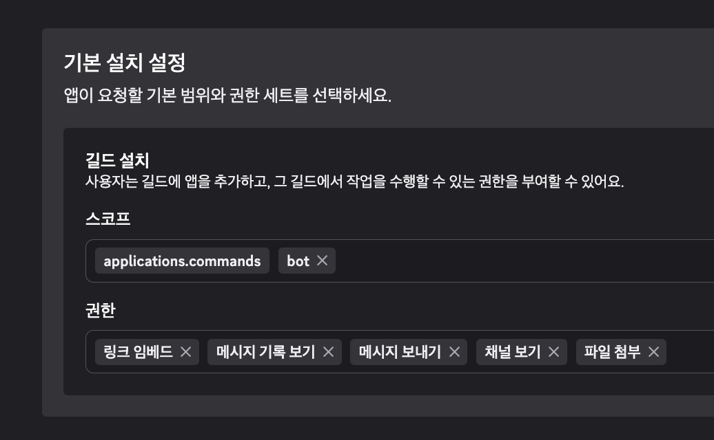
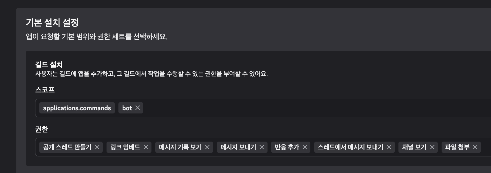
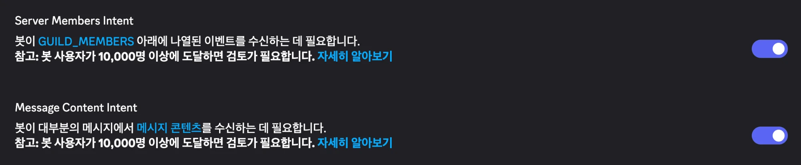

# 04. Hermes Agent 하드닝과 reader/ops 분리

## 목적

- `lab-assistant`의 **Hermes Agent v0.22.2**를 실습망 운영용으로 잠급니다.
- 모델: **ChatGPT 구독(Codex OAuth, `openai-codex`) 주력 → OpenRouter → OpenCode Zen 무료(무보존) 모델** 순으로 폴백
- 승인: `manual` + 사용자 정의 차단 목록(`approvals.deny`), cron/단발/무인 세션은 전부 거부
- **reader / ops 두 봇으로 분리**
  - `reader`: 웹·비전만. 셸·파일·코드 실행·브라우저·MCP 없음 → 프롬프트 인젝션을 당해도 손발이 없음
  - `ops`: GNS3·Windows·VNC·netmiko MCP, 수동 승인, **주인 DM만**
- Discord 게이트웨이는 사용자 서비스로 설치만 하고 **토큰이 들어올 때까지 멈춰 둠**

MCP 서버(GNS3, Windows-MCP, mcp-vnc, netmiko) 설치·검증은 [05 문서](05-mcp.md)에 있습니다.

## 사전조건

- [01](01-openstack-reset-and-base.md)~[03](03-windows-vm.md) 완료, `lab-assistant`에 Hermes 설치됨 (`~/.local/bin/hermes`, `hermes --version` → v0.22.x)
- 자리표시자
  - `<ASSISTANT_FIP>`: lab-assistant Floating IP (예: `192.168.0.202`)
  - `<YOUR_DISCORD_USER_ID>`: 본인 Discord 사용자 ID(숫자)
  - `<OPENROUTER_API_KEY>`, `<OPENCODE_ZEN_API_KEY>`, `<OPS_DISCORD_BOT_TOKEN>`, `<READER_DISCORD_BOT_TOKEN>`
- 설정 키는 **설치된 v0.22.2에 번들된 문서**(`~/.hermes/hermes-agent/website/docs/`)와 설정 템플릿, 소스로 확인했습니다. 온라인 문서(hermes-agent.nousresearch.com)는 버전이 달라 `auth.adopt_external_logins` 같은 항목이 빠져 있을 수 있습니다.

## 설계: 프로필 구조

| 프로필 | 위치 | 역할 | 비밀값(.env) |
|---|---|---|---|
| `default` (= **ops**) | `~/.hermes/` | 운영 봇. 멀티플렉스 게이트웨이의 호스트 | 모델 키, ops 봇 토큰, `GNS3_API_KEY`, `WINDOWS_MCP_AUTH_KEY`, `VNC_PASSWORD` |
| `reader` | `~/.hermes/profiles/reader/` | 읽기 전용 대화/조사 봇 | 모델 키, reader 봇 토큰 **만** |

- v0.22는 **게이트웨이 하나가 모든 프로필을 서빙**(multiplex, 기본값)합니다. 프로필마다 `.env`, MCP 연결, 허용 사용자, 승인 기록이 분리되고, MCP 자식 프로세스는 자기 프로필의 비밀값만 받습니다.
- 봇 토큰은 프로필마다 **서로 다른 Discord 봇**이어야 합니다(같은 토큰이면 두 번째가 `duplicate_credential`로 정지).
- **주의: 프로필은 샌드박스가 아닙니다.** 같은 리눅스 사용자로 돌기 때문에 reader 격리는 "도구를 아예 주지 않는 것"으로 만듭니다(`platform_toolsets` + `agent.disabled_toolsets` + `no_mcp`).

## 절차

모든 명령은 `lab-assistant`의 `ubuntu` 사용자로 실행합니다.

```bash
ssh -i ~/.ssh/<lab-key> ubuntu@<ASSISTANT_FIP>
export PATH=$HOME/.local/bin:$PATH
```

### 0. 남은 업데이트 잠금 파일 정리

중단된 세션이 남긴 `~/.hermes/.hermes-update-in-progress.lock`(0바이트)이 있으면, hermes 프로세스가 없는지 확인 후 지웁니다.

```bash
pgrep -af 'hermes' | grep -v pgrep     # 아무것도 없어야 함
rm -f ~/.hermes/.hermes-update-in-progress.lock
```

### 1. 원본 백업

```bash
cp ~/.hermes/config.yaml ~/.hermes/config.yaml.orig-template
cp ~/.hermes/.env ~/.hermes/.env.orig-template && chmod 600 ~/.hermes/.env.orig-template
```

### 2. ops(기본 프로필) 설정

[scripts/hermes/config.ops.example.yaml](../scripts/hermes/config.ops.example.yaml)의 키를 `~/.hermes/config.yaml`에 병합합니다. 템플릿(주석 포함)을 통째로 덮어쓰지 말고 **해당 키만 바꾸세요**(`_config_version` 유지). 스칼라는 CLI로도 됩니다.

```bash
hermes config set model.provider openai-codex
hermes config set model.default gpt-5.6-terra        # 자리표시자, 로그인 후 확인
hermes config unset model.base_url                    # 템플릿의 openrouter base_url 제거 (중요)
hermes config set auth.adopt_external_logins false
hermes config set approvals.mode manual
hermes config set approvals.cron_mode deny
hermes config set fallback.min_switch_reset_seconds 180
hermes config set security.allow_private_urls false
hermes config set security.allow_lazy_installs false
hermes config set agent.bot_mode_protocol false
hermes config set unauthorized_dm_behavior ignore
hermes config set terminal.cwd /home/ubuntu/hermes-work/ops
mkdir -p ~/hermes-work/ops ~/hermes-work/reader && chmod 700 ~/hermes-work/*
# 리스트/맵(fallback_providers, approvals.deny, platform_toolsets, discord, mcp_servers)은
# 예시 파일을 보고 `hermes config edit`로 붙여 넣습니다.
```

핵심 값과 이유:

| 키 | 값 | 이유 |
|---|---|---|
| `auth.adopt_external_logins` | `false` | `~/.codex`, Claude Code 로그인을 빌려 쓰지 않음(회전 refresh 토큰 충돌 방지). Hermes 자체 로그인만 사용 |
| `model` | `openai-codex` / `gpt-5.6-terra` | ChatGPT Plus 구독. **모델 ID는 자리표시자** — 플랜별 사용 가능 모델은 Hermes 문서에 없음. 로그인 후 `hermes model`로 확인 |
| `fallback_providers` | openrouter → opencode-zen `deepseek-v4.1-flash-free` | Plus는 5시간/주간 사용 창이 있어 폴백 필수. Zen 무료 모델 중 DeepSeek V4.1 Flash Free / GLM-5.3-Flash Free / MiniMax M3.1 Flash Free는 Zen 문서상 무보존 예외 목록에 없음(Big Pickle, MiMo, Nemotron 등은 학습/로그 사용 → 제외) |
| `fallback.min_switch_reset_seconds` | `180` | 한도 해제까지 3분 미만이면 갈아타지 않고 기다림. 폴백은 세션당 1회 전환 |
| `approvals.mode` | `manual` | 위험 명령은 항상 사람 승인 |
| `approvals.cron_mode`/`single_query_mode`/`unattended_mode` | `deny` | 사람이 없는 실행 경로는 위험 명령 차단 |
| `approvals.deny` | `*Format-Volume*`, `*diskpart*`, `*Remove-Item*-Recurse*`, `curl\|sh`류, ssh 터널(`-R`/`-D`), `.env`/키 파일 접근 등 | yolo·승인보다 먼저 무조건 차단(fnmatch, 대소문자 무시). YAML에서는 반드시 따옴표 |
| `security.allow_private_urls` | `false` | 웹 도구 SSRF 차단 유지(MCP 서버 연결과는 무관) |
| `security.allow_lazy_installs` | `false` | 채팅 중 패키지 자동 설치 금지 → Discord 의존성은 아래 3단계에서 명시 설치 |
| `agent.bot_mode_protocol` | `false` | `message_agent`(봇 간 메시지) 주입 끔 |
| `unauthorized_dm_behavior` | `ignore` | 허용되지 않은 DM에 페어링 코드도 보내지 않음 |
| `discord.ignored_channels` + `.env DISCORD_IGNORED_CHANNELS=*` | `*` | **ops는 서버 채널을 전부 무시 → DM 전용** |
| `discord.allow_bots` | `none` | 다른 봇(reader 포함)의 메시지 무시 |
| `platform_toolsets.discord` | terminal, file, web, … + `gns3, windows, vnc, netmiko` | MCP 서버 이름을 적으면 그 서버만 허용(allowlist). browser·code_execution·delegation·cronjob 제외 |
| `mcp_servers.*.trust` | `untrusted` | `readOnlyHint`가 없는 MCP 도구 호출은 전부 승인 필요(이번 서버들은 주석이 없어 사실상 모든 호출이 승인 대상) |

### 3. Discord 의존성 명시 설치

`allow_lazy_installs: false`이므로 discord.py를 미리 설치합니다.

```bash
hermes pm install --extra discord
hermes doctor | grep discord.py      # ✓ discord.py
```

### 4. `.env` 자리표시자

`~/.hermes/.env` 끝에 [scripts/hermes/ops.env.example](../scripts/hermes/ops.env.example) 형식으로 추가하고 **값은 비워 둡니다**(사용자가 채움). MCP 비밀값(`GNS3_API_KEY`, `WINDOWS_MCP_AUTH_KEY`, `VNC_PASSWORD`)은 [05 문서](05-mcp.md)에서 채웁니다.

```bash
chmod 600 ~/.hermes/.env
```

### 5. reader 프로필

기본 프로필을 **복제하지 않고** 빈 프로필로 만듭니다(복제하면 ops의 MCP 비밀값이 따라옴).

```bash
hermes profile create reader --no-skills \
  --description "Read-only research/chat bot: web+vision only, no shell/files/code/browser/MCP"
hermes -p reader config unset model.base_url
# config.reader.example.yaml + (ops와 같은) model/fallback/auth/approvals/security/discord 블록 병합
hermes -p reader config edit
cat scripts/hermes/reader.env.example   # 형식 참고 → ~/.hermes/profiles/reader/.env 에 추가(값은 비움)
chmod 600 ~/.hermes/profiles/reader/.env
```

reader 제한:

- `platform_toolsets.cli/discord: [web, vision, todo, memory, session_search, clarify, no_mcp]`
- `agent.disabled_toolsets`: terminal, code_execution, browser, file, computer_use, delegation, cronjob, skills, image_gen, video_gen, discord_admin, kanban, connections
- `mcp_servers: {}`

### 6. 게이트웨이 서비스 (설치만, 시작 안 함)

```bash
sudo loginctl enable-linger ubuntu
hermes gateway install --no-start-now --start-on-login
systemctl --user is-enabled hermes-gateway.service   # enabled
systemctl --user is-active hermes-gateway.service    # inactive (토큰 넣기 전까지 정상)
```

기본 프로필의 게이트웨이 하나가 reader까지 서빙합니다(`hermes -p reader gateway install`은 하지 않음). 재부팅되면 토큰이 비어 있어도 서비스는 뜨지만 연결할 플랫폼이 없어 아무 일도 하지 않습니다.

## 사용자가 직접 할 일

1. **ChatGPT(Plus) 로그인 — 기기 코드 방식**. 명령이 URL과 코드를 출력하면 브라우저에서 입력합니다.

   ```bash
   hermes auth add openai-codex               # ops(기본 프로필)
   hermes -p reader auth add openai-codex     # reader도 쓰려면 (안 하면 reader는 OpenRouter로 폴백)
   hermes model                               # Plus에서 보이는 모델 확인 후 model.default 교체
   hermes config set model.default <확인한-모델-ID>
   ```

2. **OpenRouter / OpenCode Zen 키**를 두 프로필의 `.env`에 넣습니다.

   ```bash
   nano ~/.hermes/.env                         # OPENROUTER_API_KEY=, OPENCODE_ZEN_API_KEY=
   nano ~/.hermes/profiles/reader/.env         # 같은 키 (또는 reader 전용 키)
   ```

   OpenRouter 폴백 모델(`anthropic/claude-sonnet-5.5`)도 자리표시자입니다. 원하는 도구 호출 지원 모델로 바꾸세요.

3. **Discord 봇 2개 생성.** 아래 [Discord 봇 만들기](#discord-봇-만들기-ops--reader) 절차를 ops용, reader용으로 한 번씩 따라 합니다.
4. **토큰과 본인 ID 입력.** 본인 ID는 Discord 설정 → 고급 → 개발자 모드를 켠 뒤, 내 프로필을 우클릭해서 **ID 복사**로 얻습니다.

   ```bash
   nano ~/.hermes/.env                  # DISCORD_BOT_TOKEN=<OPS 봇>  DISCORD_ALLOWED_USERS=<내 ID>
   nano ~/.hermes/profiles/reader/.env  # DISCORD_BOT_TOKEN=<READER 봇> DISCORD_ALLOWED_USERS=<내 ID>
   ```

5. **게이트웨이 시작**

   ```bash
   hermes gateway start
   hermes gateway status                # Serves: default, reader
   journalctl --user -u hermes-gateway -f
   ```

6. ops 봇에는 **DM으로만** 말을 겁니다(서버 채널은 무시). reader 봇은 서버 채널에서 `@멘션`으로 부릅니다.

### Discord 봇 만들기 (ops / reader)

[Discord Developer Portal](https://discord.com/developers/applications)에서 봇 두 개를 같은 절차로 만듭니다. 이름은 구분되게 짓습니다(예: `lab-ops`, `lab-reader`). 차이는 **권한 목록뿐**입니다.

화면 이름은 한국어 UI 기준이고, 괄호 안이 영어 UI 이름입니다. 2026-10 기준으로 확인했습니다. 초대 설정은 **OAuth2 메뉴가 아니라 설치(Installation) 메뉴**에서 합니다. OAuth2 메뉴(Client Secret, 리디렉션, URL 생성기)는 건드릴 필요가 없습니다.

#### 1) 앱 생성

오른쪽 위 **New Application** → 이름 입력 → 약관 동의 → **Create**.

#### 2) 설치 (Installation) 메뉴

1. **설치 콘텍스트 (Installation Contexts)**
   - `길드 설치 (Guild Install)`만 체크합니다.
   - `사용자 설치 (User Install)`는 해제합니다. 새 앱은 둘 다 켜져 있습니다.
2. **설치 링크 (Install Link)**: `Discord 제공 링크 (Discord Provided Link)`를 선택합니다.
3. **기본 설치 설정 (Default Install Settings) → 길드 설치**
   - **스코프**: `applications.commands`, `bot` 두 개를 넣습니다. `applications.commands`는 슬래시 명령과 승인 버튼에, `bot`은 봇 사용자에 필요합니다.
   - `bot`을 넣으면 **권한** 칸이 나타납니다. 봇별로 아래 표대로 고릅니다. 칸에 글자를 입력하면 목록이 걸러집니다.
4. 변경 사항을 **저장**합니다.

| 권한 (한국어 UI) | 영어 UI | ops | reader | 용도 |
|---|---|:-:|:-:|---|
| 채널 보기 | View Channels | ✅ | ✅ | 필수 |
| 메시지 보내기 | Send Messages | ✅ | ✅ | 필수 |
| 링크 임베드 | Embed Links | ✅ | ✅ | 필수. 응답과 승인 카드가 임베드로 표시됨 |
| 파일 첨부 | Attach Files | ✅ | ✅ | 필수. 스크린샷 등 파일 전송 |
| 메시지 기록 보기 | Read Message History | ✅ | ✅ | 필수 |
| 공개 스레드 만들기 | Create Public Threads | | ✅ | 멘션할 때마다 스레드 생성 (`auto_thread`) |
| 스레드에서 메시지 보내기 | Send Messages in Threads | | ✅ | 스레드 안에서 답변 |
| 반응 추가 | Add Reactions | | ✅ | 처리 상태 표시 👀 ✅ ❌ |

ops는 DM으로만 대화하므로 필수 5개만 줍니다. 서버에는 DM을 열기 위해서만 들어갑니다.

**ops 설정 화면:**



**reader 설정 화면:**



**절대 주지 말 권한**

- 관리자 (Administrator)
- 감사 로그 보기
- 메시지 관리, 메시지 고정
- 채널·역할·웹후크·서버 관리 등 "~관리"로 끝나는 권한 전부
- @everyone 멘션
- 추방, 차단
- 말하기, 동영상 등 음성 권한

#### 3) 봇 (Bot) 메뉴

1. **Privileged Gateway Intents**
   - `Message Content Intent`: **켜기 (필수).** 꺼져 있으면 Discord가 연결을 거부해서 봇이 오프라인으로 남습니다.
   - `Server Members Intent`: **켜기.** Hermes 문서에서 필수로 표시합니다.
   - `Presence Intent`: 끄기.

   

2. **Reset Token** → 토큰을 복사합니다. 이 화면을 벗어나면 다시 볼 수 없습니다. 이 토큰을 `.env`의 `DISCORD_BOT_TOKEN`에 넣습니다.
   - ops 토큰은 `~/.hermes/.env`, reader 토큰은 `~/.hermes/profiles/reader/.env`에 넣습니다.
   - 같은 토큰을 두 프로필에 넣으면 두 번째 게이트웨이가 `duplicate_credential`로 멈춥니다.

#### 4) 서버에 추가

1. 설치 메뉴의 **설치 링크** 칸에서 링크를 복사해 브라우저로 엽니다.
2. **서버에 추가**를 누르고 내 서버를 고른 뒤 승인합니다.
3. 나만 있는 **비공개 서버**를 따로 만들어 쓰기를 권장합니다.

#### 5) (선택) 추가 후 잠그기

다른 사람이 이 봇을 자기 서버에 넣지 못하게 막습니다.

1. 설치 메뉴에서 **설치 링크**를 `없음 (None)`으로 바꿉니다. 이걸 먼저 해야 다음 단계가 됩니다.
2. 봇 메뉴에서 **Public Bot**을 끕니다.

#### 6) (선택) reader를 채널 하나로 묶기

1. 서버 설정 → 역할에서 reader 봇 역할의 **채널 보기**를 끕니다.
2. `#reader` 채널 → 채널 편집 → 권한에서 그 역할에만 채널 보기, 메시지 보내기, 스레드 권한을 허용합니다.

이렇게 하면 reader는 다른 채널을 아예 읽지 못합니다.

출처: [Discord: Building your first Discord Bot](https://docs.discord.com/developers/quick-start/getting-started) · [Discord: Developing a User-Installable App (설치 콘텍스트/설치 링크)](https://docs.discord.com/developers/tutorials/developing-a-user-installable-app) · [Hermes: Discord](https://hermes-agent.nousresearch.com/docs/user-guide/messaging/discord)

## 검증

```bash
hermes auth list                         # "auth.adopt_external_logins is false" 문구
hermes config check                      # Config version ✓
hermes mcp list                          # ops: gns3/windows/vnc/netmiko
hermes -p reader mcp list                # 비어 있어야 함
hermes tools list --platform discord     # ops: terminal/file/web/... + MCP 4개, browser/code_execution ✗
hermes -p reader tools list --platform discord   # web, vision, todo, memory, session_search, clarify 만
hermes doctor | grep -E "discord.py|Codex|OpenRouter"
```

이 환경에서 확인된 결과: reader는 6개 툴셋만 활성, MCP 없음. ops는 MCP 4개 등록, `gns3`는 패턴 4개로 11개 도구 제외.

## 트러블슈팅 (gotchas)

- **Bot Mode/프로필은 자동 격리가 아님.** 같은 OS 사용자라서 reader에게 `terminal`/`file`을 주면 ops의 `.env`도 읽을 수 있습니다. 도구 자체를 빼는 것이 격리입니다.
- **ops가 forward된 원문을 받지 않게 하기**: `message_agent`는 데스크톱 Bot Mode가 `profile.yaml`에 `ui_meta: {hermes-bots: …}` 표식을 쓰고 세션 제목이 정확히 `Bot Chat`일 때만 생깁니다. 헤드리스 설치에서는 **그 표식을 만들지 마세요**. 추가로 `agent.bot_mode_protocol: false`, `discord.allow_bots: none`으로 봇 경유 입력을 막았습니다. 단, Hermes에는 "다른 봇이 보낸 원문 수신 금지" 같은 별도 스위치는 없습니다(문서상 `message_agent`는 원문이 아니라 보낸 봇이 다시 쓴 메시지를 전달). **사용자가 reader 출력을 복사해 ops에 붙여 넣는 것은 막을 수 없으므로** 그런 붙여넣기는 하지 마세요.
- **DM 전용 스위치는 없음.** `DISCORD_IGNORED_CHANNELS=*`(코드상 `*` 지원)로 모든 서버 채널을 무시하게 해서 DM 전용으로 만듭니다.
- **`model.base_url` 잔재**: 템플릿/새 프로필에 `https://openrouter.ai/api/v1`이 들어 있습니다. `openai-codex`로 바꿨다면 반드시 `config unset model.base_url`.
- **Plus 플랜 모델/한도**: Hermes 문서는 플랜별 모델·쿼터를 설명하지 않습니다. `hermes model`의 목록이 기준이고, 한도에 걸리면 `fallback_providers`로 넘어갑니다(세션당 1회).
- **`approvals.deny`는 셸 문자열 정책**이지 샌드박스가 아닙니다. `*curl*|*sh*`는 `curl … | sha256sum`도 막습니다(의도된 보수적 설정).
- **`security.allow_lazy_installs: false`** 상태에서 새 플랫폼/기능이 의존성 부족으로 실패하면 `hermes pm install --extra <name>`으로 명시 설치합니다.
- **`hermes update`** 는 멀티플렉스 마이그레이션 등을 자동 수행할 수 있습니다. 업데이트 뒤 `hermes gateway status`와 위 검증을 다시 보세요.
